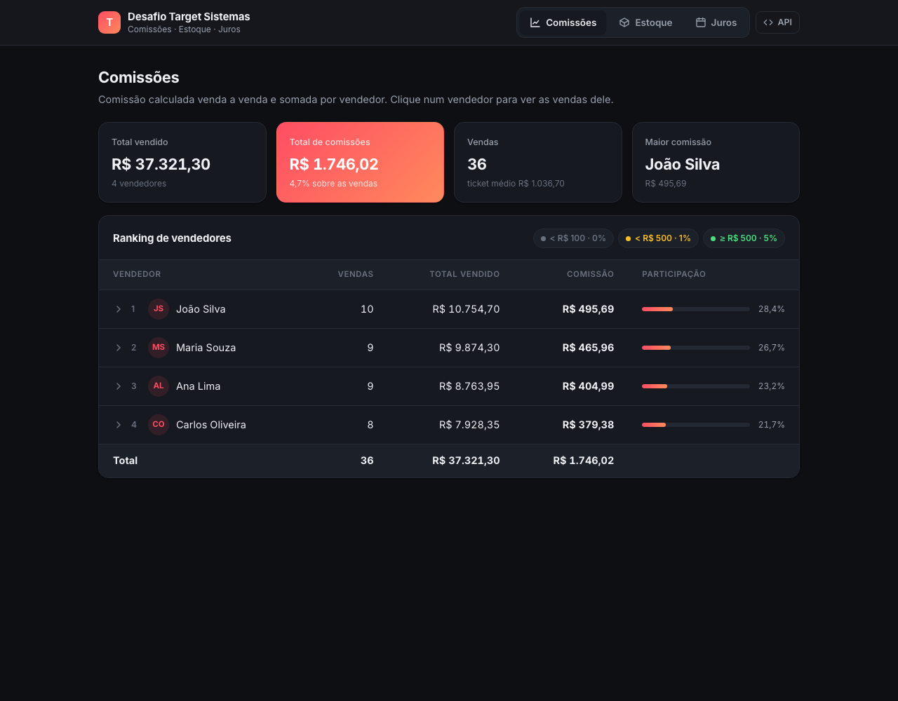
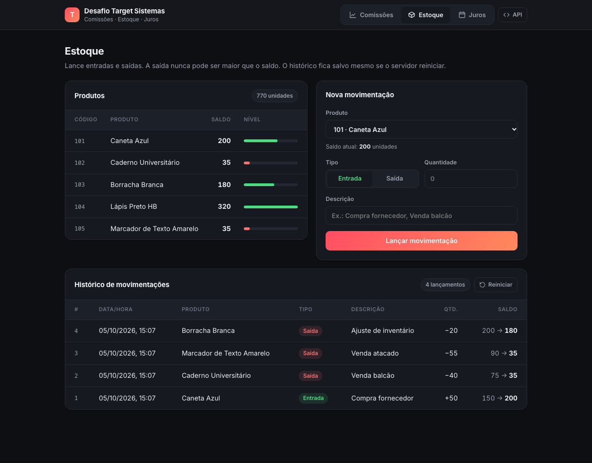

# Desafio Técnico – Target Sistemas

Solução em **C# / .NET 8** para os três exercícios do desafio, com app de console, interface web, API documentada no Swagger e testes automatizados.



## Estrutura

```
DesafioTarget.sln
├── src/
│   ├── Desafio.Core/          # Regras de negócio (sem dependência de console)
│   │   ├── Comissoes/         # Exercício 1
│   │   ├── Estoques/          # Exercício 2
│   │   └── Juros/             # Exercício 3
│   ├── Desafio.App/           # Aplicação console (menu) + arquivos JSON em Dados/
│   └── Desafio.Web/           # Interface web + API REST (ASP.NET Core, Swagger)
├── tests/Desafio.Tests/       # Testes unitários e de integração da API (xUnit)
├── sql/estoque.sql            # Modelagem de referência do estoque em SQL Server
└── Dockerfile                 # Imagem da interface web
```

A lógica fica no `Desafio.Core`, separada da entrada e saída. O app de console e a interface web usam as mesmas regras, sem duplicar código.

## Como executar

Pré-requisito: [.NET 8 SDK](https://dotnet.microsoft.com/download).

```bash
dotnet run --project src/Desafio.App   # abre o menu no terminal
dotnet run --project src/Desafio.Web   # abre a interface em http://localhost:5080
dotnet test                            # roda os testes
```

Ou, com Docker (sem instalar o .NET):

```bash
docker build -t desafio-target .
docker run --rm -p 8080:8080 desafio-target   # http://localhost:8080
```

### Interface web

Uma aba para cada exercício, usando os mesmos arquivos JSON do app de console:

- **Comissões:** indicadores gerais, ranking dos vendedores e, ao clicar num vendedor, cada venda com a faixa aplicada e a comissão gerada.
- **Estoque:** saldo e nível de cada produto, formulário de entrada/saída e histórico. As movimentações são gravadas em `App_Data/movimentacoes.json` e continuam lá quando o servidor reinicia. O botão *Reiniciar* volta ao saldo inicial.
- **Juros:** valor e vencimento, com o cálculo detalhado (dias de atraso, juros e valor atualizado).



### API

A documentação interativa fica em **http://localhost:5080/swagger**.

| Método | Rota | O que faz |
|--------|------|-----------|
| GET | `/api/comissoes` | Comissão por vendedor, com o detalhe de cada venda |
| GET | `/api/estoque/produtos` | Produtos com o saldo atual |
| GET | `/api/estoque/movimentacoes` | Histórico de movimentações |
| POST | `/api/estoque/movimentacoes` | Lança entrada/saída (`400` com a mensagem se for inválida) |
| DELETE | `/api/estoque/movimentacoes` | Apaga o histórico e volta ao saldo inicial |
| GET | `/api/juros?valor=1500&vencimento=2026-09-25` | Juros até hoje |

### Testes

- **Unitários** (`Desafio.Core`): faixas e arredondamento da comissão, todas as validações do estoque, restauração do histórico e cálculo de juros.
- **Integração** (`ApiTests`): sobem a API em memória com `WebApplicationFactory` e testam os endpoints, incluindo os erros `400` e a persistência do histórico entre reinicializações.

## Exercício 1 – Comissões

Lê `Dados/vendas.json` e calcula a comissão por venda:

| Valor da venda      | Comissão |
|---------------------|----------|
| abaixo de R$ 100,00 | 0%       |
| abaixo de R$ 500,00 | 1%       |
| a partir de R$ 500  | 5%       |

As faixas ficam numa lista (`FaixaComissao`), então mudar a regra não exige reescrever `if`s.

Resultado com os dados do desafio:

| Vendedor        | Vendas | Total vendido | Comissão  |
|-----------------|-------:|--------------:|----------:|
| João Silva      | 10     | R$ 10.754,70  | R$ 495,69 |
| Maria Souza     | 9      | R$ 9.874,30   | R$ 465,96 |
| Ana Lima        | 9      | R$ 8.763,95   | R$ 404,99 |
| Carlos Oliveira | 8      | R$ 7.928,35   | R$ 379,38 |

## Exercício 2 – Movimentação de estoque

Lê `Dados/estoque.json` e permite lançar entradas e saídas. Cada movimentação tem:

- **Id único**, gerado automaticamente (sequencial);
- **Tipo** (`Entrada` / `Saida`) e **descrição** livre (ex.: "Compra fornecedor", "Venda balcão");
- quantidade, data/hora, estoque anterior e **estoque final**, que é exibido ao usuário.

Validações: produto inexistente, quantidade zero ou negativa, descrição vazia e **saída maior que o saldo** (o estoque nunca fica negativo). As mensagens de erro dizem o que aconteceu, por exemplo:

> Saldo insuficiente: o produto 102 (Caderno Universitário) tem 75 em estoque e foi solicitada a saída de 80.

No app de console o histórico fica em memória durante a execução. Na interface web ele é gravado em arquivo e reaplicado ao iniciar, passando pelas mesmas validações. O arquivo `sql/estoque.sql` mostra como isso seria persistido em SQL Server (tabelas, constraints e uma procedure transacional).

## Exercício 3 – Juros por atraso

Recebe um valor e uma data de vencimento e calcula os juros até hoje.

## Premissas adotadas

1. **Comissão:** o arredondamento (2 casas, metade para cima) é feito **por venda**, já que cada venda gera sua própria comissão. O total do vendedor é a soma dessas comissões.
2. **Juros:** o enunciado cita "juros" e "multa de 2,5% ao dia". Considerei **juros simples de 2,5% por dia corrido de atraso**: `juros = valor × 0,025 × dias`. Para vencimento hoje ou futuro, os juros são zero.
3. **Dinheiro:** todos os valores usam `decimal`, não `double`, para evitar erros de ponto flutuante.
4. **Testabilidade:** a data de "hoje" é passada como parâmetro para a calculadora de juros, e o relógio pode ser injetado no serviço de estoque.
